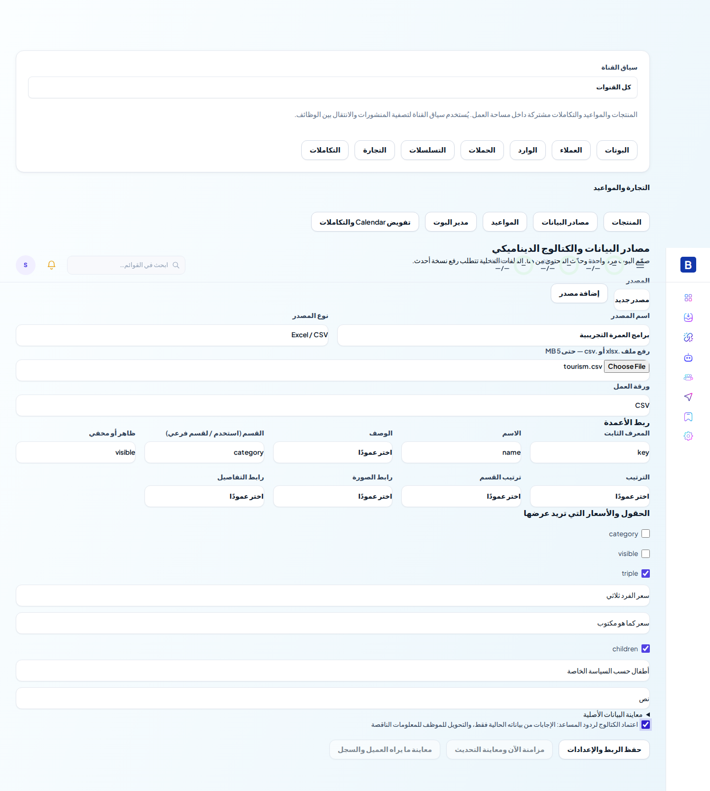
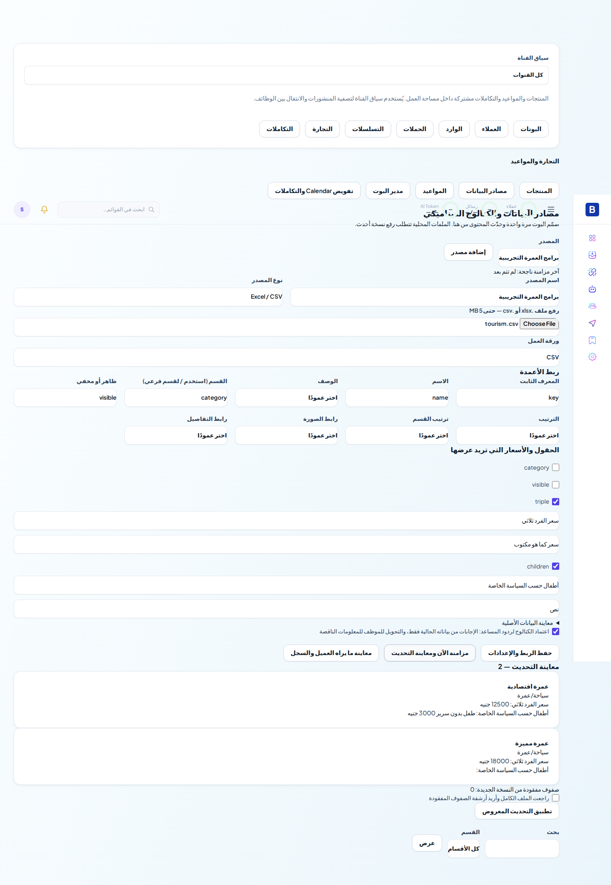
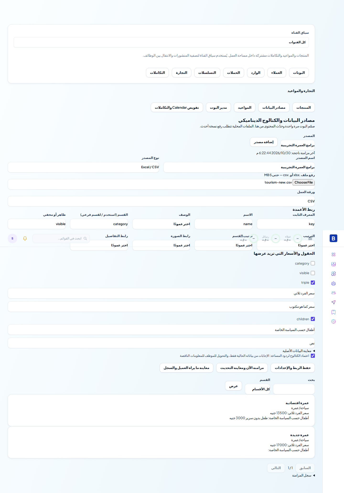
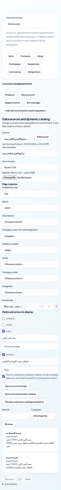
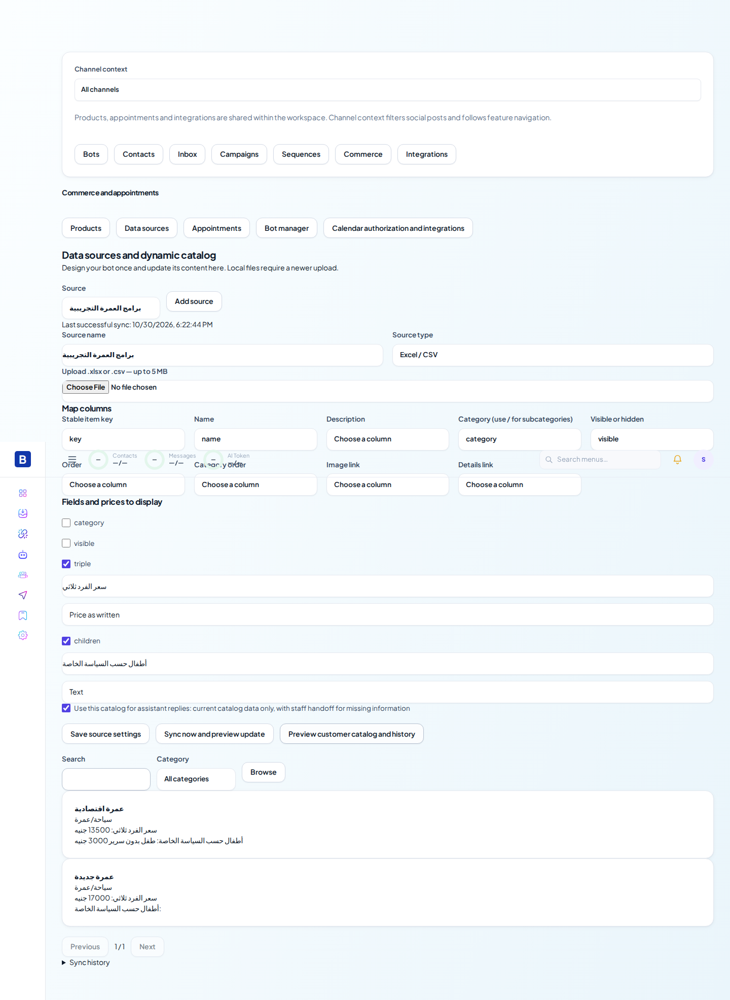
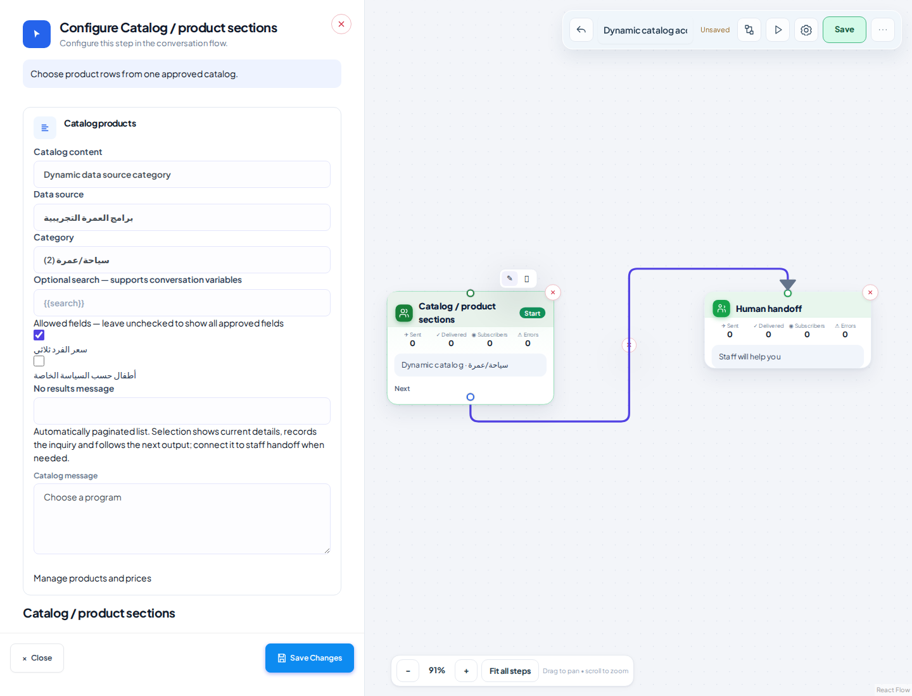
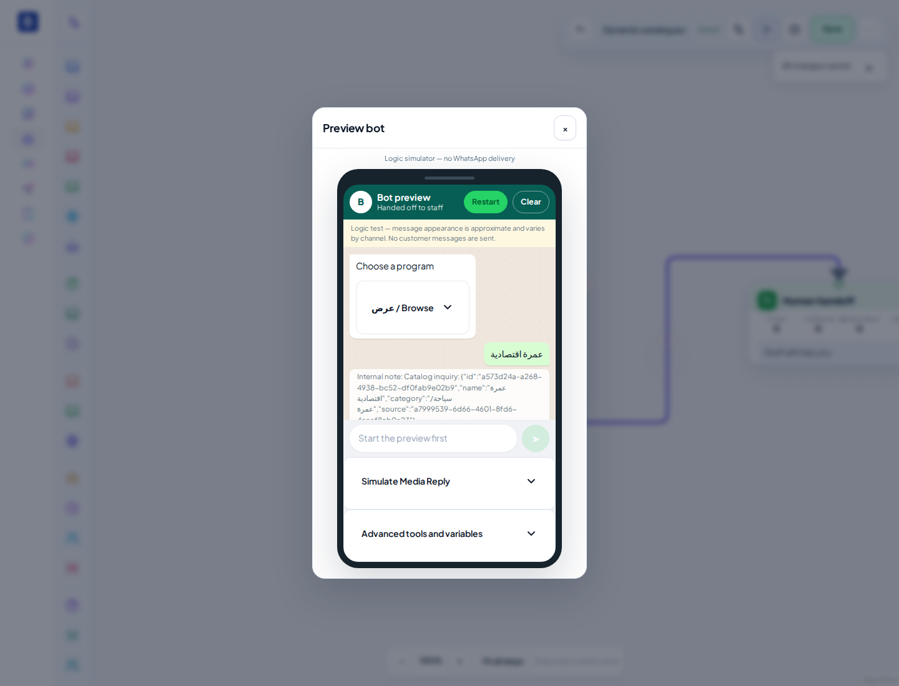

# تقرير تنفيذ وقبول مصادر البيانات والكتالوج الديناميكي

تاريخ التحقق: 30 أكتوبر 2026 بتوقيت القاهرة.

**النتيجة:** النسخة مهيأة للمعاينة المحلية والمراجعة. لم يحدث دمج إلى main أو نشر على Railway أو اتصال بعملاء حقيقيين. قبول Google وWhatsApp الحي، والترحيل الكامل على PostgreSQL خادم مستقل، لم يُعتمد في هذه الجلسة. لا يمثل هذا التقرير اعتماد المنصة كلها للبيع.

## الفرع والمصدر

- المستودع: `hendhafez5566-arch/Boat-two`.
- فُحصت الفروع والـPRs الفعلية. أحدث نسخة كانت `preview/botsailor-rebuild04-20261026` عند `61de42a`، متقدمة على فرعي PR #1 وPR #2. أُعيد جلب الفروع ولم يظهر تحديث أحدث على فرع المصدر.
- فرع التسليم: `feat/smart-data-sources-20261030`، مشتق مباشرة من تلك النسخة. فرع منفصل للـPR يحافظ على أحدث تعديلات المعاينة دون الكتابة فوق الفروع الأخرى.
- أساس الـPR: `preview/botsailor-rebuild04-20261026`، وليس main. الفرق يشمل هذه الميزة فقط.
- Commits الكود: `62425bc` ثم `b75d53a`. Commit التقرير والأدلة يأتي بعدهما، وHEAD النهائي موثق في الـPR ورسالة التسليم.
- [مقارنة الفرع على GitHub](https://github.com/hendhafez5566-arch/Boat-two/compare/preview/botsailor-rebuild04-20261026...feat/smart-data-sources-20261030).

## الموجود الذي أُعيد استخدامه

| الموجود | الاستخدام في الإضافة |
|---|---|
| `GoogleService` وGoogle OAuth وتشفير الاتصال | نفس الحسابات وتحديث الرموز وبوابات الأثر الخارجي؛ أُضيف اختيار الملفات وبيانات أوراق العمل بصلاحيات قراءة |
| `sheet.ts` | محلل CSV الحالي؛ بقيت عقدة `sheet_fetch` العامة والخاصة تعمل، مع تحذير خصوصية للرابط العام |
| `catalog_products` و`CommerceService` | نفس عناصر الكتالوج ومعرفاتها، مع ربط المصدر والحقول المرنة والأرشفة؛ دون محرك منتجات موازٍ |
| عقدة `catalog` وFlowEngine | إعداد اختياري للمصدر والقسم والحقول والبحث والصفحات، مع بقاء مسار المنتجات الثابتة |
| `FlowsService` والمصمم والمحاكي والإصدارات | حفظ ونشر واسترجاع وتجربة بنفس النظام؛ بلا إعادة تصميم عامة |
| `AiService` | مسار إجابة مقيد بالكتالوج الحالي يحترم تشغيل المساعد وتعطيل الوكيل |
| CRM وInbox والتسليم للموظف | نفس سمات العميل والملاحظات و`handled_by=human` وأحداث التسليم الحالية |
| `DatabaseService.withTenant` وRLS | عزل المصدر والعناصر والمعاينات والسجلات وصلاحيات المالك والمدير |

## ما تم تطويره

- إدارة مصادر متعددة، ربط الأعمدة بصريًا وتسميتها، ومعاينة الصفوف والأخطاء والحالة والسجل.
- Google Sheets الخاص: OAuth، اختيار الملف والورقة أو النطاق، ومعاينة ومزامنة يدوية وتلقائية. لا يتطلب نشر الشيت للعامة.
- XLSX متعدد الأوراق وCSV، رفع نسخة أحدث للمصدر نفسه، ومنع المعرف المكرر والصيغ والروابط غير الآمنة والملفات الفارغة أو الناقصة بنيويًا.
- Migration `095_smart_data_sources.sql`: مصادر ومعاينات أحادية الاستخدام وسجلات تحديث، وحقول إضافية على المنتجات وفهارس وعزل RLS ومحدد مصادر المزامنة المستحقة.
- تحديث ذري بمعرف ثابت، وحماية المراجعة من المعاينة القديمة. الفشل يحتفظ بالنسخة السليمة ويظهر حالة تقادمها. الصف المفقود لا يؤرشف إلا بتأكيد يدوي، ولا حذف نهائي.
- كتالوج عام: مسار قسم/قسم فرعي، ترتيب عناصر وأقسام، وصف وصورة ورابط، وأسعار نصية متعددة وحقول مختلفة دون فرض نشاط أو فئات أطفال أو حسابات.
- تصفح أقسام وعناصر بصفحات وبحد أقصى 10 اختيارات في القائمة مع الرجوع. المصدر أو القسم يتحدث دون تعديل الـFlow.
- فحص الظهور عند الاختيار نفسه، بما يمنع الأزرار القديمة من استرجاع تفاصيل عنصر أُخفي بعد عرض القائمة.
- ردود مقيدة بالصفوف الحالية، وبحث عربي/إنجليزي محافظ، ومطابقة `XL` مستقلة عن `XXL`، ومتابعة العنصر المختار حتى خارج أول صفحة بحث. لا تُخزن الأسعار في معرفة مولدة، ولا تُنفذ تعليمات من محتوى الشيت.
- تسجيل معرف العنصر واسمه وقسمه ومصدره في `catalogSelection` وملاحظة داخلية؛ ثم متابعة مسار المصمم والتسليم الحالي. لا إنشاء حجز أو مخزون أو خصم مقاعد.
- واجهة عربية/إنجليزية وموبايل، وإعدادات مكملة داخل عقدة الكتالوج دون تغيير Sidebar أو Dashboard.

## نتائج الاختبارات

| التحقق | النتيجة وحدود الدليل |
|---|---|
| API بالكامل | 184 اختبارًا ناجحًا، صفر فشل أو تخطٍ؛ يشمل الوحدات ومجموعات PostgreSQL/PGlite القديمة والجديدة |
| اختبارات مكتبة الواجهة الحالية | 10 ناجحة، صفر فشل |
| إعادة تحقق مركزة للمصدر وOAuth ومسار المساعد | 17 ناجحة؛ هذه تتداخل مع مجموعة API ولا تُجمع عليها |
| API TypeScript | ناجح |
| Next production build وTypeScript | ناجح، 42 صفحة |
| ESLint للملفات المعدلة والجديدة | ناجح |
| ESLint العام | ظهر في البداية 177 ملاحظة، منها 176 خطأ وواحد تحذير. أُصلحت الملاحظات في الملفات الجديدة؛ الباقي في ملفات قديمة خارج النطاق. لا يُدعى أن lint العام أصبح ناجحًا |
| قبول المتصفح | رحلة فعلية: Chromium ← Next الإنتاجي ← Nest/الحراس والخدمات الفعلية ← PostgreSQL/PGlite معزول. رفع وربط ومعاينة وتطبيق، ثم تحديث سعر وإضافة وإخفاء، وحفظ ونشر واسترجاع Flow وتجربة اختيار وتسليم في المحاكي |
| اللغات والشاشات | عربية RTL وإنجليزية LTR؛ 1440×1100 و390×844، دون overflow أفقي أو أخطاء JavaScript في الرحلة |
| دليل الصور | 8 لقطات فعلية، ليست صورًا مولدة أو واجهات مرسومة للتقرير |

الأدلة: [API TAP](acceptance/2026-10-30-smart-data/api-tests-final.tap)، [الاختبارات المركزة](acceptance/2026-10-30-smart-data/catalog-tests.txt)، [بناء API](acceptance/2026-10-30-smart-data/api-build.txt)، [بناء الواجهة](acceptance/2026-10-30-smart-data/web-build.txt)، [نتيجة المتصفح](acceptance/2026-10-30-smart-data/browser-results.json).

اختبارات PostgreSQL تستخدم محرك PostgreSQL الحقيقي داخل PGlite مع دور `app_user` وسياسات RLS، وليست نتائج SQL ثابتة. بيئة قبول المتصفح تحتوي مخططًا مركّزًا للعقود المختبرة. لم يُشغّل كامل تسلسل migrations 001–095 على خادم PostgreSQL مستقل أو نسخة إنتاج في هذه الجلسة؛ اختُبرت 086 و095 والتغييرات المطلوبة على المخطط المعزول. النقل النهائي يحتاج تجربة الترحيل على نسخة قاعدة آمنة أولًا.

## السيناريوهات المثبتة

| النشاط | الإثبات |
|---|---|
| السياحة | أسعار ثلاثي وأطفال مخصصة؛ معرف ثابت بعد إعادة المزامنة؛ إضافة برنامج وسعر جديد؛ إخفاء واستعادة؛ أرشفة المفقود بتأكيد مع إبقاء سجله؛ سؤال عن سعر موجود وآخر غير موجود؛ اختيار وتسجيل CRM وتسليم فعلي لحالة human في PostgreSQL مع نقل إرسال وهمي |
| المطعم | 300 صف داخل PostgreSQL، أقسام وفرز وصفحات، بحث بيتزا كبيرة، تعديل سعر وإخفاء، ومتابعة عنصر خارج أول صفحة |
| الملابس | ألوان ومقاسات وأسعار مرنة، مخفي غير قابل للبحث، وعدم مطابقة XL مع XXL/XXXL أو تجاهل L |
| العزل والأمان | شركتان، منع الموظف من مصدر البيانات، رفض غياب المصادقة، عدم استخدام معرف مصدر أو معاينة من شركة أخرى، ومنع معاينة مستهلكة أو مراجعة قديمة |
| الفشل | أعمدة متغيرة ومعرفات مكررة وصفوف فارغة وفشل Google؛ لا استبدال للنسخة السليمة. إعادة المزامنة التلقائية بعد تعافي Google لا تكرر العناصر وتزيل حالة الخطأ |
| الملفات والحجم | CSV عربي واقتباسات وXLSX متعدد الأوراق؛ رفض صيغ وامتدادات غير مسموحة واقتباس CSV مبتور؛ تحقق بنيوي لـ10,000 صف وحد الزيادة. الاستيراد المتكامل الكبير المختبر داخل PostgreSQL هو 300 صف، وليس 10,000 |
| البوتات الحالية | اختبارات المحرك القديمة ناجحة؛ حفظ ونشر واسترجاع ومحادثة بحالة مستعادة، وعدم إسقاط وظائف المصمم السابقة |

## الصور

## حدود الاعتماد

1. Google OAuth اختُبر بنقل وهمي موثوق: النطاقات، الحالة أحادية الاستخدام، رفض الصلاحية المنتهية أو العضوية الملغاة، تشفير الرموز، القراءة ورفض الكتابة. لم يستخدم حساب Google حي؛ واجهة اختيار الملفات والنطاقات تحتاج قبولًا حيًا بحساب مفوض وإعداد المشغل.
2. لم تُرسل رسالة WhatsApp حقيقية أو يُختبر شكل القائمة على هاتف حقيقي. حدود القوائم والمحرك والمحاكي اختُبرت محليًا.
3. ردود الكتالوج الحالية بحث نصي محافظ وعرض مباشر للمحتوى. ليست فهمًا دلاليًا عامًا لكل صياغة أو توصيات AI؛ السؤال غير المطابق يحوّل للموظف. وضع الكتالوج المعتمد لا يمزج قاعدة المعرفة القديمة. هذه الحدود موضحة في واجهة التفعيل ودليل الاستخدام.
4. التجربة المحلية لا تثبت جاهزية المنصة كلها للبيع أو أمان جميع الوظائف القديمة. لا ادعاء «مكتمل 100%» ولا اعتماد خارجي من الاختبارات الوهمية.

[دليل الاستخدام والتشغيل وخطوات النشر اليدوي على Railway](SMART_DATA_SOURCES_AR.md).
