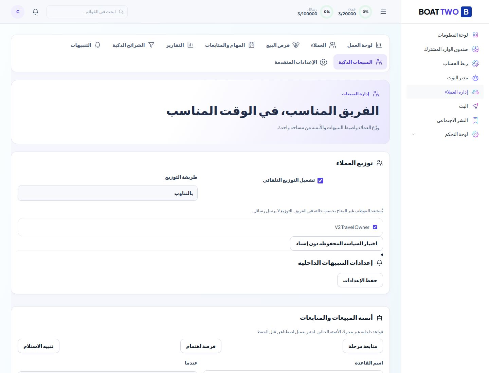
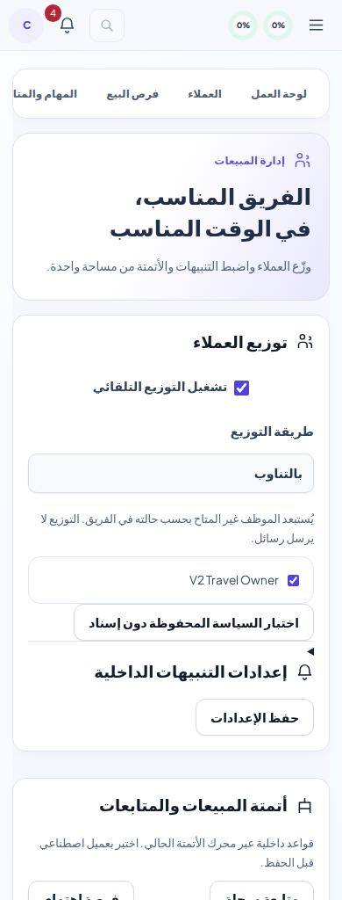
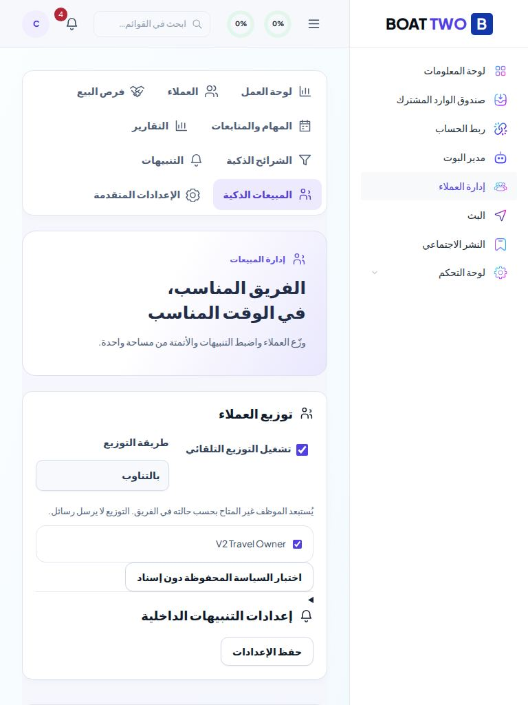
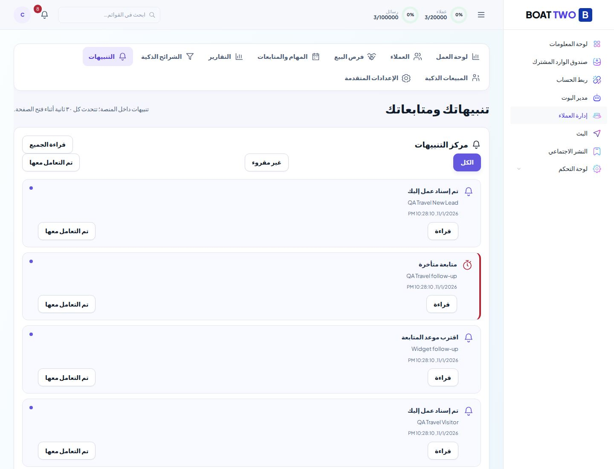
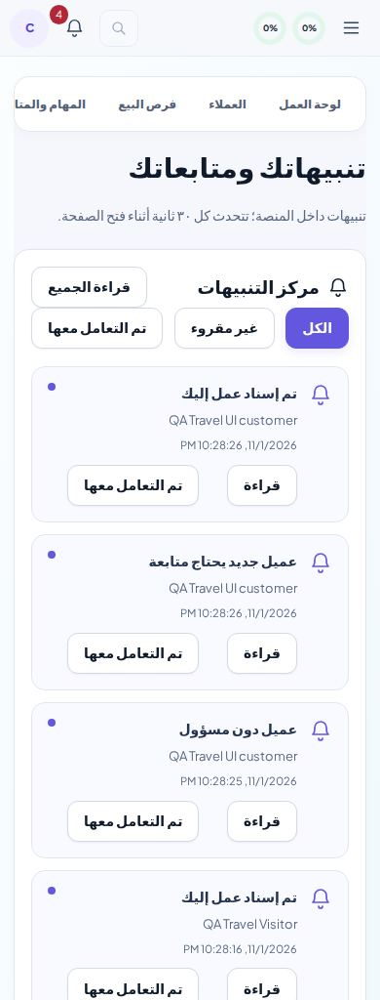
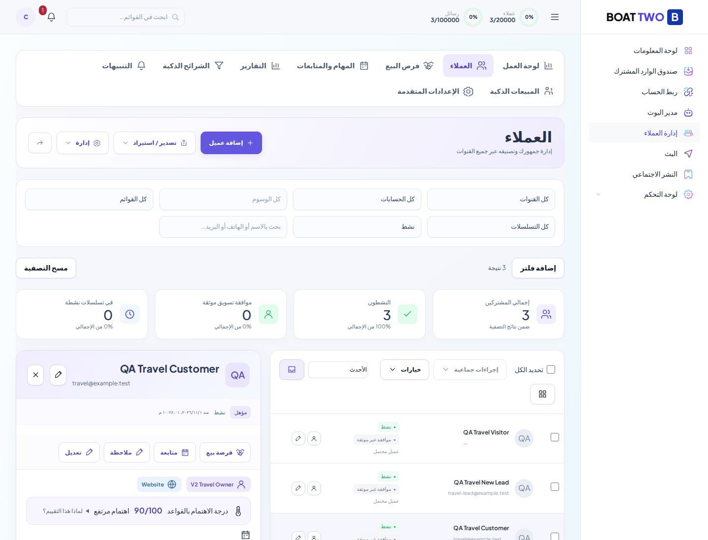
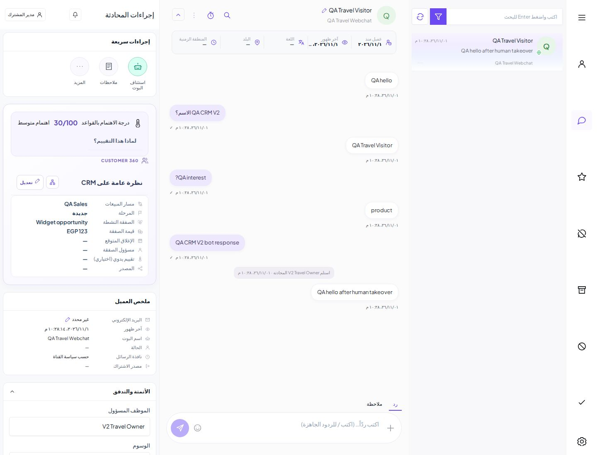
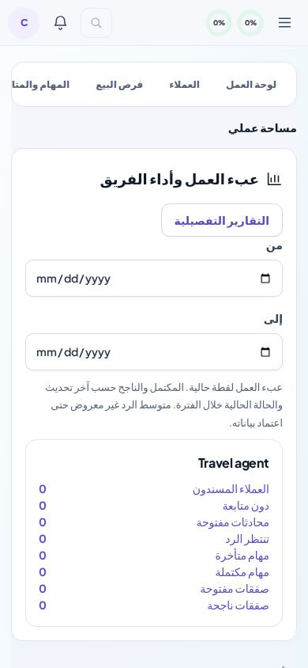
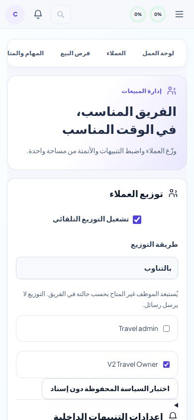
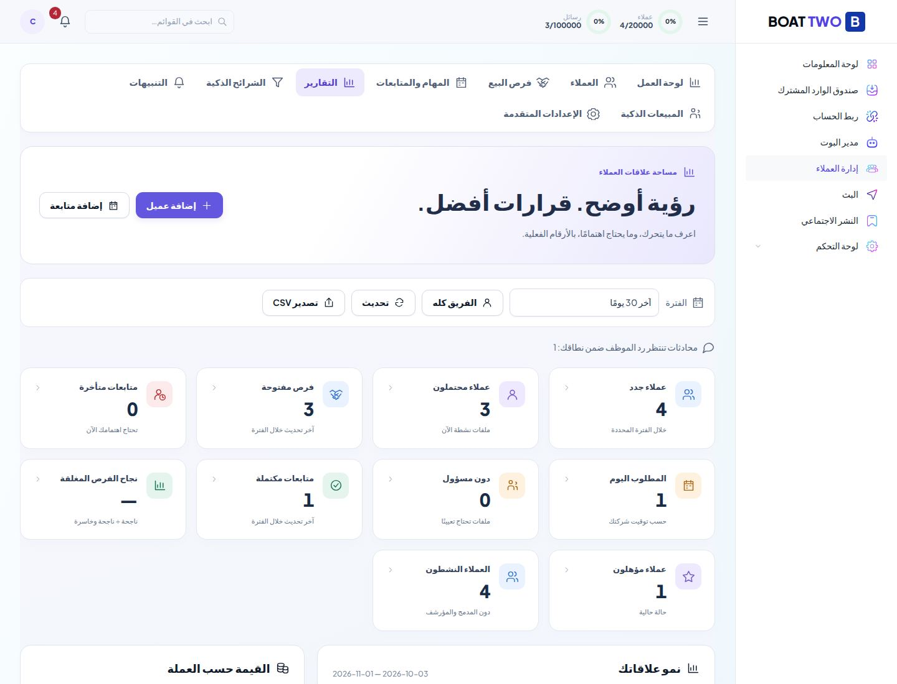

# Boat Two — CRM V3: تقرير التنفيذ والقبول

هذه نسخة Preview مبنية على CRM V2 المعتمد `419de0a3e264cba19cbdd11e98aca7bb8e7d21ba`، مع الحفاظ على تصميمه ومحركه وContact ID الحالي. PR: https://github.com/hendhafez5566-arch/Boat-two/pull/8، وقاعدته فرع V2؛ لا دمج إلى main.

## الوظائف المكتملة والفرق عن V2

| المجال | ما أضيف فوق V2 |
|---|---|
| التنبيهات | جرس بعدّاد، قائمة تغلق بـEscape وخارجها، صفحة الكل/غير المقروء/تم التعامل معها، قراءة فردية وجماعية وروابط السجل. تسعة أنواع داخلية فقط، مع ضبط الوقت والأولوية والمستلمين المؤهلين. |
| التوزيع | تفعيل/تعطيل، تناوب، أقل مجموع عملاء ومحادثات مفتوحة، وقواعد حسب القناة والقسم والوسم. اختيار المشاركين، احترام available والقسم، اختبار السياسة دون كتابة إسناد، وسجل تغيير المسؤول. اختيار الموظف والحفظ تحت قفل الشركة داخل معاملة واحدة. |
| الأتمتة | امتداد المحرك الموجود، لا محرك ثانٍ. أحداث البوت والوسوم والحالة والمراحل والإغلاق والمحادثة والاستلام وتأخر المتابعة. تعيين موظف، تنبيه داخلي، حقل مخصص typed، نقل صفقة الحدث، ومتابعة مرتبطة بالصفقة. قوالب وملخص ومعاينة اصطناعية قبل الحفظ؛ إدارة AND/OR والإيقاف والإصدارات وسجل الفشل من المحرر الموجود. |
| التكرار والمحاولات | إيصالات لكل إجراء داخل معاملته، منع تكرار فرصة مفتوحة لنفس القاعدة/العميل/الخط، وحماية once-per-root الموجودة لمنع حلقات الأحداث. إعادة المحاولة الموجودة محفوظة. اختبار فشل قاعدة بيانات اصطناعي ثم تكرار التسليم أنتج ملاحظة واحدة ومتابعة واحدة. |
| التقييم | نقاط V2 محفوظة افتراضيًا. إشارات قابلة للضبط: آخر تواصل خلال فترة، عدد رسائل العميل، إجابة اهتمام محفوظة، وخصم الخمول/الصفقة الخاسرة. Hot/Warm/Cold، أسباب موجبة وسالبة، ووقت الحساب. ليس AI أو احتمال بيع. |
| المبيعات | متابعة مرتبطة بصفقة مع مفتاح أجنبي للشركة والعميل؛ إشعارات الركود والإغلاق المتوقع؛ حفظ Kanban وتاريخ المراحل وأسباب الخسارة وفصل العملات. |
| الفريق | بطاقات العملاء ودون متابعة والمحادثات والمنتظرة والمهام والصفقات، وفترة للتقرير وروابط للقوائم. مساحة الموظف تعرض عمله؛ إعدادات التوزيع والتقييم والأتمتة للإدارة. |
| Customer 360 وInbox | أحداث حفظ البوت واستلام المحادثة وتغيير المسؤول في السجل. رابط التنبيهات من Inbox، وروابط دقيقة للمحادثة/المهمة/الصفقة من التنبيه. |

الترحيلان 102 و103 إضافيان فقط. لا حذف أو إعادة إنشاء لبيانات العملاء، ولا جداول اتصال موازية. مفاتيح ربط المهمة بالصفقة مؤجلة داخل المعاملة للحفاظ على إمكانية دمج العملاء. لم نضع قيدًا فريدًا على الفرص يمنع دمج سجلات العميل؛ منع التكرار يتم داخل معاملة وقفل الشركة.

## رحلة الشركة الاصطناعية

تُكرر الرحلة على سياحة ومطعم ومتجر داخل بيئة محلية منفصلة:

1. رسالة من Webchat فعلي إلى البوت المنشور في شركة الاختبار فقط.
2. سؤال الاسم ثم الاهتمام وحفظهما في Contact واحد.
3. توزيع العميل وإسناده حسب السياسة.
4. شرط اهتمام يفعّل الأتمتة وينشئ فرصة ومتابعة وتنبيهًا داخليًا.
5. ظهور التنبيه وقراءة الجميع، واختبار سياسة التوزيع دون تغييرها وحفظ الإعدادات ثم Reload.
6. الموظف يضغط «إيقاف البوت» في Inbox؛ تصل رسالة إضافية ويبقى handled_by=human دون إعادة سؤال البوت.
7. تغيير مرحلة Kanban بالسحب وبالقائمة البديلة، وإكمال متابعة متأخرة وتحقق API.
8. Customer 360 وإجراءات المتابعة والتقارير والتصدير بفترة محددة.

جُرّبت الواجهة بأدوار Owner وAdmin وAgent في شركات اصطناعية. لم نستخدم قاعدة المالك لكتابة هذه الاختبارات.

## نتائج الاختبارات

**69 مجموعة API V3 و41 رحلة متصفح و210 اختبارات Regression و45 مجموعة API V2 ناجحة**. ESLint: 173 خطأ قديم وتحذير واحد على الأساس والحالي، صفر جديد.

الأرقام النهائية في `api-results.json` و`browser-results.json` و`technical-results.json`.

- API V3: اختبارات فعلية للمتحكمات والخدمات والمعاملات، بثلاث شركات، بما فيها ستة عملاء متزامنين، توزيع 3/3، available=false، تعارض الإعدادات، منع قراءة تنبيه موظف آخر ومنع تعديل إعدادات الشركة عبر Agent.
- الأتمتة: AND/OR، فرصة واحدة بعد تحديثات متعددة، توقف القاعدة عند تعطيلها، حفظ صفر وfalse في الحقول typed، نقل مرحلة الصفقة دون حلقة، وربط المتابعة بصفقة الحدث ومسؤول العميل.
- الاختبار الاصطناعي للمعاينة لا يُنفّذ إجراءات أو رسائل. شروط العلاقات التي لا تتوافر في العميل الاصطناعي لا تُعد مطابقة؛ المعاينة ليست ضمانًا لكل تكامل خارجي.
- خطأ مؤقت محقون في نقل قاعدة البيانات المحلية أثناء الإجراء: المعاملة تُرجع كتابة الملاحظة السابقة؛ بعد المحاولة الثانية وإعادة التسليم تظل ملاحظة واحدة ومهمة واحدة. ذلك يختبر الأمان المحلي، لا فشل WhatsApp حي.
- PostgreSQL/RLS: جميع الترحيلات الفعلية على PGlite، مع اختبار مباشر جديد لرفض INSERT وUPDATE والقراءة عبر الشركة الأخرى في جداول التنبيهات والإيصالات. PGlite محرك PostgreSQL مضمّن؛ ليس خادم PostgreSQL خارجيًا أو اختبار ضغط إنتاجيًا.
- Regression: ملفات الاختبارات كلها، وليس glob جزئيًا. نتيجة المجموعة النهائية موثقة في technical-results.
- ESLint: أساس V2 فيه 173 خطأ وتحذير واحد. المقارنة الحالية موثقة؛ لا تعطيل للقواعد ولا إخفاء لأخطاء الأساس.
- الصور من Chromium محلي حقيقي ببيانات اصطناعية. ليست صورًا مولدة ولا دليلًا على WhatsApp حي.

## الصور

### المبيعات الذكية

### التنبيهات

### الملف والمحادثة

### الأدوار والإنجليزية

## الأخطاء التي عولجت والتحقق منها

- فصل اختيار الموظف عن حفظ الإسناد كان يسمح بقرارات متزامنة على عبء قديم؛ أُدخل الاثنان في معاملة وقفل الشركة.
- مفتاح التوزيع الجديد المعطل أصبح يتغلب على auto_assign القديم إذا كانت السياسة الجديدة محفوظة صراحةً.
- الفرص المؤتمتة كانت قابلة للتكرار مع تحديثات مختلفة؛ أضيف مصدر القاعدة وفحص فرصة مفتوحة تحت القفل.
- تسليم المتابعة المؤجلة مباشرة أكثر من مرة كان يحتاج حماية مستقلة؛ أضيفت إيصالات الإجراءات.
- أُصلح فلتر «كل الحالات» الذي كان يحوّل القيمة الفارغة إلى شرط لا يطابق أي سجل؛ اختبار رابط صفقة محددة ناجح.
- روابط التنبيهات تستعمل أسماء معاملات الواجهات الفعلية، مع فلتر id للمهمة/الصفقة.
- أُبقيت روابط الصفقة/المهمة قابلة لنقل العميل أثناء Merge داخل معاملة، وحذف عضوية الموظف يحذف تنبيهاته التابعة.
- خُفّضت استعلامات مركز التنبيهات بكتابة المستلمين في INSERT SELECT وإعادة استخدام الإعدادات في المسح. لا يُحمّل مستمع التنبيهات ملف العميل لكل حدث غير متعلق بعميل جديد.
- تحديثان لبيانات الاختبار: قاعدة الكتالوج المصغرة تحتاج updated_at وdomain_events بعد نشر حدث حفظ البوت؛ سؤال الاهتمام الاصطناعي يحتاج saveToContact=true بحسب عقد محرك البوت. لم يُغيّر سلوك حفظ الأسئلة المعتمد لإخفاء خطأ الاختبار.

## النشر والسلامة

المشروع الوحيد `boat-two-ui-preview`؛ البيئة `preview`. خدمات التطبيق الوحيدة المستهدفة `boat-preview-api` و`boat-preview-web`، مع pgvector وRedis الحاليين. تفاصيل SHA وDeployments والصحة في `RELEASE.md`، وخطة الرجوع في `ROLLBACK.md`.

لم تُنشأ موارد Railway جديدة. لم يتغير WABA أو Token أو Webhook أو مخطط البوت النشط، ولم تُرسل رسالة لعميل حقيقي. لا تفعيل Auto Deploy. لا استخدام Railway AI Agent.

اتصال WhatsApp لم نُعد فحصه خارجيًا في هذه الدفعة، ولا نعتبر حفظ الإعدادات أو نجاح Webchat إثباتًا له. المتصفح السحابي الحالي وصل إلى صفحة تسجيل الدخول، ولذلك فحص الداخل على النسخة المنشورة يحتاج جلسة دخول من المالك. لا نعرض بيانات دخول أو نعيد ضبط حسابه.

## الحدود وما لم يُعتمد

- لا اختبار WhatsApp حي، Google OAuth حي أو محاكاة نقل Meta تُسمّى اتصالًا حيًا. رسالة حقيقية أو تغيير إعدادات خارجية يحتاج موافقة منفصلة كما طلب المالك.
- متوسط الرد غير معروض؛ لا توجد نتيجة موثقة هنا تكفي لاعتماد تعريفه التاريخي، ولذلك لم نضع رقمًا تقريبيًا.
- محرر الشروط يدعم الحقول الأساسية والعلاقات وAND/OR الموجودة؛ شروط درجة Hot/Warm/Cold مباشرةً كشرط أتمتة ليست مضافة. شروط الحقول المخصصة وقيمة الصفقة موجودة في API، وليست لكل أنواعها عناصر مرئية متخصصة في المحرر.
- المعاينة الاصطناعية تعرض الخطة ولا تنفذها؛ التنفيذ الحقيقي موثق باختبارات API ورحلات المستخدم.
- التنبيهات الزمنية تتولد عند قراءة مركز التنبيهات، والتحديث أثناء فتحه كل 30 ثانية. لا إشعارات بريد/WhatsApp أو خدمة Push خارج التطبيق. مسح القوائم محدود لحماية الأداء؛ ليست نتيجة اختبار حمل متعدد العمال على خادم خارجي.
- التقارير المكتملة/الناجحة تستخدم آخر تحديث والحالة الحالية، كما في V2؛ ليست دفتر إيرادات بتاريخ إغلاق تاريخي.
- صلاحيات V3 تمنع إعدادات الإدارة عن Agent، وتفرض نطاق الموظف في المهام والصفقات والمؤشرات والتنبيهات. صلاحيات قراءة بيانات جهات الاتصال الأساسية السابقة لم يُعد تصميمها بهذه الدفعة.

النتيجة: وظائف ملموسة صالحة لتجربة Preview مراقبة، مع الحدود أعلاه. لا ادعاء إكمال كل بند من طلب CRM V3 أو اعتماد البيع العام قبل استكمال الشروط المتقدمة، القبول السحابي بعد الدخول، والتكاملات الحية والحمل الخارجي.
