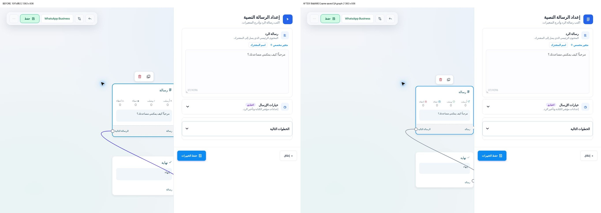

# استكمال Flow Builder — نتائج الدفعة المنشورة

هذه دفعة استكمال على PR #14، وليست إغلاقًا للمطابقة الكاملة. بدأت من HEAD الفعلي `10f1df82`؛ حافظت على الفرع والـBase والعمل السابق.

## التغييرات الفعلية

- استبدال رموز الإحصائيات المعتمدة على الخط بأيقونات SVG مستقلة، واستخدام أيقونة نوع العقدة في رأس إعداداتها.
- إزالة تلوين التوصيلات بالبنفسجي وإبهات الخطوط عند اختيار عقدة؛ الخط المرجعي المرصود رمادي `#778292` بسُمك 2px. بقيت أدوات قطع التوصيل ومنطق الرسم.
- تطبيق لون التحديد `#0d8bf1` والظل `0 4px 8px rgba(139,141,141,.15)` من القياسات المرجعية المسجلة.
- منع تكبير التركيز التلقائي إلى 110% عند فتح إعدادات العقدة؛ العرض المرصود أصبح 264px. بقي Zoom اليدوي.
- إيقاف إعادة ترتيب العقد تلقائيًا عند فتح تدفق محفوظ. كان هذا المسار يغيّر مواضع العرض ويضع حالة Unsaved دون تعديل المستخدم. بقي زر ترتيب العقد الصريح ومعالجة موضع العقد الجديدة.

## النتائج الجديدة والأدلة

| الاختبار | النتيجة | الدليل وحدوده |
|---|---|---|
| Build Web/API وTypeScript وESLint | PASS | البناء الأول على نقطة الاستكمال؛ ثم بناء Web وفحوص الملفات بعد التغييرات. |
| اختبارات API الشاملة | PASS | [216/216](api-tests.txt)، تعداد الملفات المتداخلة صراحة؛ لا يعتمد على glob سطحي. |
| رسم الأيقونات | PASS | [31 أيقونة عقدة +4 إحصائيات](icon-render-tests.txt)، SVG حقيقية دون محارف خطوط أو أهداف تركيز إضافية. |
| لون الخطوط عند اختيار عقدة متصلة/غير متصلة | PASS | حالتا SSR في نفس ملف النتائج، ثم DOM منشور يثبت اللون والسُمك والشفافية. |
| حفظ الإحداثيات والتوصيلات | PASS | [4/4](position-tests.txt)، منها إحداثيات متداخلة وسالبة وكسور، واتجاها RTL/LTR، دون تغيير البيانات الأصلية. |
| Create→Configure→Connect→Save→Reopen→Preview→Publish→Edit→Republish | PASS على HTTP المعزول | [النتائج](api-journey.json). تطبيق Nest كامل وPostgreSQL/PGlite مع RLS ومحرك الأحداث الفعلي؛ ليس اختبار UI أو مزود خارجي. |
| Owner/Admin/Agent وعزل شركة ثانية | PASS على HTTP المعزول | يتضمن السماح للمسؤول ورفض الوكيل وعزل القراءة والتعديل، ضمن النتائج الست. |
| Webchat→CRM→Human Handoff | PASS على HTTP المعزول | مرسل اصطناعي ومحادثة/عميل جديدان داخل قاعدة اختبار محلية فقط. |
| فتح/إغلاق الإعدادات والإحصائيات على النسخة المنشورة | PASS محدود | Cloud Browser بالعربية والإنجليزية على 1363×936. لم أضغط Save/Publish على تدفق المالك. |
| حالة Saved بعد الفتح دون تعديل | PASS على النسخة المنشورة | [الدليل المقروء](saved-open-evidence.json)، مقابل Unsaved قبل إزالة إعادة الترتيب عند الفتح. |
| قياسات العقد والتوصيلات المنشورة | PASS للعينات المرصودة | [DOM الفعلي](live-measurements.json): 264px، لون تحديد/ظل مرجعيان، خطان رماديان 2px وopacity1، أربع أيقونات وقيم 0/0/0/0. لا يثبت جميع أنواع العقد. |
| إعادة تشغيل مجموعة UI السابقة ذات 33 حالة | BLOCKED | مراجعة الموافقة التلقائية رفضت تجهيز Chromium المحلي استنادًا لتوجيه Cloud Browser السابق. لم أستخدم تنزيلًا أو التفافًا بديلًا؛ الاختبارات الحالية أعلاه مستقلة عنها. |
| المقاسات 320/390/768/1366/1920 والمقارنات المحمية 20/20 | BLOCKED لإعادة الاعتماد | الأرقام والصور السابقة محفوظة كأدلة تاريخية؛ لم أعد تشغيلها في هذا الاستكمال. المتصفح السحابي الحالي 1363×936. |
| الإنشاء الحي على Preview | BLOCKED وفق آخر فحص محفوظ | PLAN_LIMIT لم يُتجاوز؛ الإنشاء الجديد اختُبر معزولًا. لم تُعدّل خطة الاشتراك. |

المحاولة الأولى لدورة HTTP كانت 5 PASS و1 FAIL لأن مشغّل الاختبار لم يشغّل معالج صندوق الأحداث الداخلي. [احتُفظ بالنتيجة الأولى](api-journey-first.json)، ثم شُغّل العامل الحقيقي الموجود أصلًا في مشغّل الاختبار وأُعيدت الدورة: 6/6. لا يُقدّم ذلك كإصلاح منتج أو مزود.

## المقارنة البصرية

[قبل وبعد — نفس التدفق المحفوظ ونفس viewport](images/before-after.jpg). يتضمن الفرق المقصود إلغاء تكبير التركيز وإعادة ترتيب التحميل؛ لذلك لم تُثبت مواضع العرض اصطناعيًا لإخفاء التغيير.

[العربية بعد النشر](images/after-ar.jpg) — [الإنجليزية](images/after-en.jpg).

[مرجع Image](images/reference-image-panel.jpg) — [مرجع Random](images/reference-random-panel.jpg). لقطات المرجع مقصوصة لاستبعاد شريط الحساب ورقم الهاتف. لقطات Boat تعرض مسودة QA برسالة ترحيب عامة، بلا بيانات عملاء. لم يُنسخ كود أو أصل محمي إلى المنتج.

## الفجوات المتبقية

| العنصر | الحالة | السبب |
|---|---|---|
| Notify Contact / Row / Section | FAIL للمطابقة الكاملة | لم تُنفذ كمفاهيم مستقلة بعد. |
| Random Number Generator | FAIL للمطابقة الوظيفية | المرجع Character Set بأربع فئات وLength بحد أدنى 5 وربط Custom Field؛ Boat ما زال يستخدم نطاقًا رقميًا. لم تُخترع دلالات المجموعة الخاصة. |
| New Sequence Campaign | BLOCKED للاعتماد الكامل | تركيب حملة الجذر لم يثبت؛ مرجع الطفل Send Message After ليس بديلًا. |
| Product / Product Section والتكاملات | BLOCKED للاعتماد الكامل | إعدادات وتدفقات مزود لم تُعتمد عمليًا. |
| جميع لوحات الإعدادات والمقاسات وحالات Hover/Drag/Error | BLOCKED للمطابقة الشاملة | توجد أدلة جزئية سابقة وحالية؛ لا إثبات مستقل كامل لكل نافذة وحالة. |
| Smart Assignment وInbox/CRM كدورة UI كاملة | BLOCKED لإعادة الاعتماد | اختبارات API العامة ومسار handoff ناجحة؛ المقارنة المحمية القديمة ليست إعادة اختبار UI جديدة. |

## GitHub وRailway

- PR #14 بقي Draft، والـBase نفسه؛ لم يُدمج main.
- آخر كود منشور: `fbfa99835e99d4800f95c714cdb7f29b267940f9`؛ Commit توثيق الأدلة يأتي بعده.
- Web Deployment: `5aad01a2-9359-4812-89e2-7bb45b2573da`، حالة SUCCESS، وتحقق Cloud Browser بعده.
- API بقي على `1b75418b-378d-4a3c-b1fa-16c40baf5795`؛ لم يحتج هذا الاستكمال نشر API.
- استُخدمت خدمة Web الحالية وأدوات Railway المباشرة فقط. لا موارد أو روابط أو متغيرات جديدة؛ Sleep ظل مفعّلًا.
- الموقع: https://boat-preview-web-preview.up.railway.app

الخطوة التالية هي اعتماد بقية المفاهيم واللوحات والاختبارات المحجوبة؛ هذه النتائج لا تعلن انتهاء مطابقة Flow Builder.
